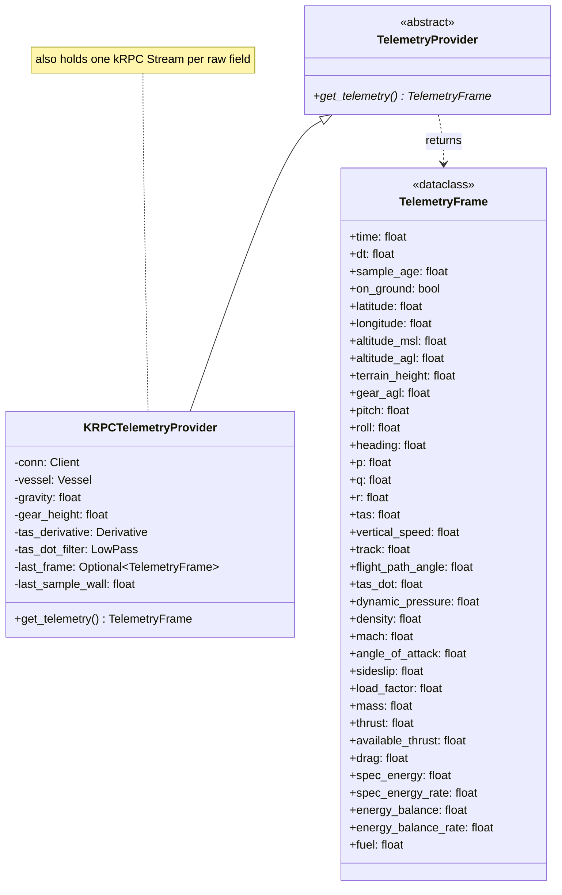

# timing
time                    # s
dt                      # s, since last sample (derived)
sample_age              # s, staleness (derived)

# state
on_ground               # bool

# position
latitude                # deg
longitude               # deg
altitude_msl            # m
altitude_agl            # m
terrain_height          # m
gear_agl                # m, altitude_agl minus gear height (derived)

# attitude
pitch                   # deg
roll                    # deg
heading                 # deg, 0-360
p                       # deg/s, body roll rate (derived)
q                       # deg/s, body pitch rate (derived)
r                       # deg/s, body yaw rate (derived)

# velocity
tas                     # m/s
vertical_speed          # m/s, positive up
track                   # deg, ground course (derived)
flight_path_angle       # deg (derived)
tas_dot                 # m/s^2, filtered (derived)

# air data
dynamic_pressure        # Pa
density                 # kg/m^3
mach                    # -
angle_of_attack         # deg
sideslip                # deg
load_factor             # g

# forces and mass
mass                    # kg
thrust                  # N, current
available_thrust        # N, at full throttle now
drag                    # N

# energy
spec_energy             # m (derived)
spec_energy_rate        # m/s (derived)
energy_balance          # m (derived)
energy_balance_rate     # m/s (derived)

# fuel
fuel                    # units

